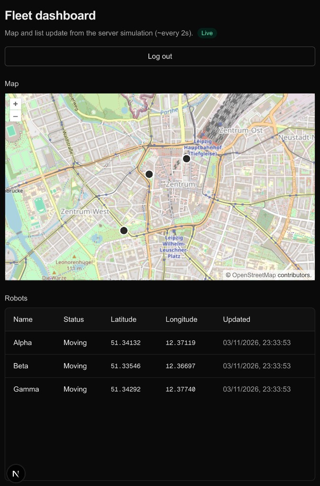
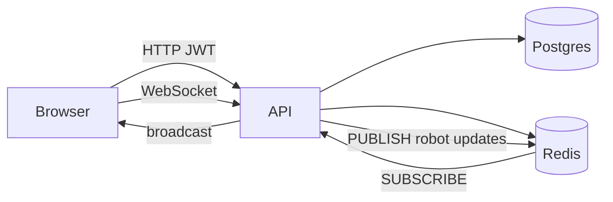

# Mini-Fleet Monitor

Web app to monitor a fleet of virtual robots: JWT login, REST for the robot list, OpenLayers map, and live position updates over WebSocket. Backend uses Postgres, Redis (cache + pub/sub), and a 2s simulation tick.

**Demo login:** `admin@test.com` / `test123`

## Screenshots

| Dashboard (map + live list) |
| --- |
|  |

Seeded robots start near **Leipzig**; the simulation moves them every ~2 seconds.

## Quick start

### Full stack with Docker Compose

From the repo root:

```bash
docker compose up --build
```

| Service | URL |
| --- | --- |
| Frontend | http://localhost:3000 |
| API | http://localhost:4000 |
| Postgres (host) | `localhost:5433` |
| Redis | `localhost:6379` |

The frontend container sets `NEXT_PUBLIC_API_URL=http://localhost:4000` so the **browser** on your machine talks to the published API port.

Fresh database (re-seed from scratch):

```bash
docker compose down -v
docker compose up --build
```

### Local development

**Backend** (Postgres + Redis via Compose):

```bash
docker compose up db redis -d
cp backend/.env.example backend/.env
cd backend && bun install && bun run dev
```

**Frontend** (separate terminal):

```bash
cd frontend
echo 'NEXT_PUBLIC_API_URL=http://localhost:4000' > .env.local
bun install && bun run dev
```

Open http://localhost:3000/login. If port 4000 is already used by Compose `api`, stop it: `docker compose stop api`.

More detail: [backend/README.md](backend/README.md). API tests: `cd backend && bun test` (Postgres and Redis must be running; see that README).

## Architecture



- **Postgres:** users, robot positions (`robots` table). Drizzle migrations run on API startup; empty DB is seeded with three robots.
- **Redis:** 10s cache for `GET /robots`; pub/sub channel `minifleet:robot:updates` so multiple API instances can share live events (each instance forwards to its WebSocket clients).
- **Simulation:** interval in the API moves every robot; each move persists and publishes an update. The timer starts on boot; the dashboard can pause and resume it.
- **Frontend:** Next.js App Router; token in `localStorage`; dashboard merges WebSocket `robot:update` messages into map markers and table.

## Project layout

| Path | Role |
| --- | --- |
| `backend/` | Express API, Drizzle, WebSocket hub, simulation |
| `frontend/` | Next.js UI, OpenLayers map |
| `docker-compose.yml` | Postgres, Redis, API, frontend |
| `aufgabe.md` | Original task specification (German) |

## Assignment checklist

Implemented against `aufgabe.md`: auth, protected `GET /robots`, automatic moves, WebSocket live updates, OpenLayers map, Docker Compose with Postgres + Redis, optional Redis cache and pub/sub.
